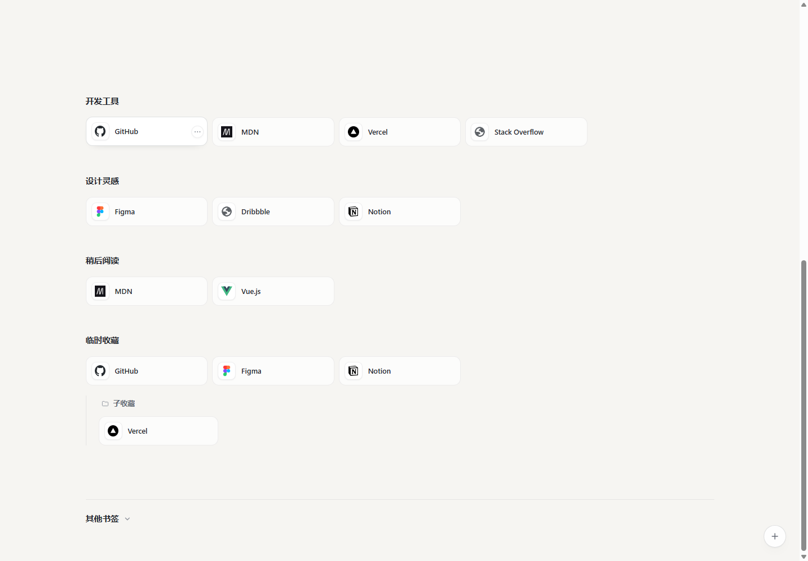
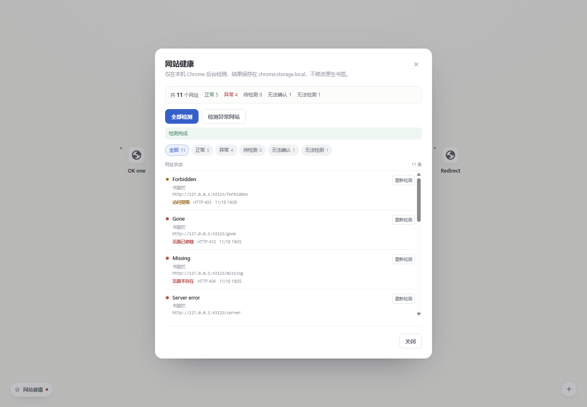

# Bookmark Home

[](https://github.com/Raycoi/bookmark-home/actions/workflows/ci.yml)
[](LICENSE)
[](https://developer.chrome.com/docs/extensions/develop/migrate)

把 Chrome 原生书签整理成一个干净、快速、可直接管理的新标签页。

Bookmark Home 直接使用 Chrome 书签，不建立第二套书签数据库。打开新标签页即可搜索、整理和检查书签；跨设备同步仍由 Chrome 自己负责。

> **当前版本**：`0.1.0`。GitHub Release 已发布；Chrome Web Store 尚未上架。普通用户请从 [Release v0.1.0](https://github.com/Raycoi/bookmark-home/releases/tag/v0.1.0) 下载 ZIP 安装。


## 功能

### 新标签页

- 直接展示 Chrome 书签栏、其他书签和嵌套文件夹。
- 常用网站以图标卡片展示，文件夹保持原有分类。
- 支持 Google、Bing、百度和 DuckDuckGo 搜索切换。
- 使用 Chrome 本地 `_favicon` 图标，不请求第三方 favicon 服务。
- 响应式布局，适配不同窗口宽度。

### 书签管理

- 新增、编辑、删除书签。
- 新建、重命名、删除文件夹。
- 将书签或文件夹移动到其他位置。
- 拖拽调整顺序和移动位置。
- 右键菜单、更多菜单和快捷操作入口。

| 书签管理 | 新增书签 |
|:---:|:---:|
|  |  |

### 网站健康检查

- 可选地检查书签网址是否可以访问。
- 显示正常、跳转、页面不存在、页面已移除、访问受限、服务器异常和无法确认等状态。
- 支持单个网站重新检测。
- 支持全部检测、异常网站筛选、批量重检和取消未执行的检测。
- 跳过内网和本机地址，避免把健康检查用于内网探测。



## 数据与隐私

- **唯一数据源**：Chrome 原生书签。扩展不建立独立书签数据库，也不复制书签到扩展存储。
- **不上传书签**：没有开发者后端、第三方健康检查 API 或独立云同步。
- **跨设备同步**：由 Chrome 自身的账号同步负责，不由本扩展实现。
- **搜索偏好**：只把搜索引擎 ID 保存到 `chrome.storage.sync`。
- **健康检查记录**：只保存在本机 `chrome.storage.local`，清除扩展数据后需要重新检测。
- **不使用统计**：没有遥测、广告、崩溃上报或用户行为分析。

### 为什么需要访问所有网站的权限？

网站健康检查需要向书签中的 HTTP/HTTPS 地址发起请求，以获取 HTTP 状态和跳转结果，因此使用了 `host_permissions: <all_urls>`。

扩展不会：

- 注入网页脚本；
- 读取网页正文或 DOM；
- 读取 Cookie、浏览历史或登录状态；
- 在健康检查请求中携带登录 Cookie。

健康检查不读取页面内容，无法识别软 404、登录页或依赖 JavaScript 渲染的页面。完整说明见 [隐私政策](PRIVACY.md) 和 [权限用途](store/PERMISSIONS.md)。

## 安装

当前正式安装方式是 **GitHub Release**。Chrome Web Store 尚未上架，因此需要手动加载解压后的扩展目录。

1. 打开 [Release v0.1.0](https://github.com/Raycoi/bookmark-home/releases/tag/v0.1.0)。
2. 下载 `bookmark-home-0.1.0-chrome.zip` 并解压。
3. 打开 `chrome://extensions`。
4. 开启右上角“开发者模式”。
5. 点击“加载已解压的扩展程序”，选择解压后的目录。
6. 打开新标签页。

Chrome 不能直接加载 ZIP，必须选择解压后的目录。Chrome Web Store 上架后，会改为商店一键安装。

开发者从源码构建的步骤见下一节。ZIP 产物位于 `.output/bookmark-home-0.1.0-chrome.zip`。

## 开发与构建

环境要求：

- Node.js >= 22
- pnpm 10

```bash
corepack enable
pnpm install --frozen-lockfile

pnpm dev            # 开发模式
pnpm check          # lint + typecheck + 单元测试 + build + zip + 产物校验
pnpm build          # 生产构建
pnpm zip            # 打包 Chrome ZIP
pnpm verify:extension
```

真实 Chrome 测试需要本地 Chrome、独立用户目录和测试 HTTP 服务，运行方式见 [真实 Chrome 测试](scripts/browser/README.md)。测试覆盖摘要和已知边界见 [测试说明](docs/TESTING.md)。

## 技术栈

- [WXT](https://wxt.dev/) 构建 Chrome Manifest V3 扩展。
- [Vue 3](https://vuejs.org/) + TypeScript 实现新标签页。
- [Vitest](https://vitest.dev/) 运行单元测试。
- 后台使用 MV3 Service Worker、`chrome.bookmarks`、`chrome.storage` 和 `chrome.alarms`。

更完整的架构、数据流、健康检查队列和 Service Worker 说明见 [技术架构](docs/TECHNICAL.md)。

## 已知限制

- 仅支持 Chrome，不提供 Firefox、Edge 或 Safari 版本。
- 主页主要展示书签栏和其他书签；移动设备/额外区域书签不在主页展示。
- 删除操作没有回收站或撤销，需要确认后执行。
- 触屏设备不能使用 HTML5 拖拽，但仍可通过菜单移动书签。
- 健康检查无法识别软 404、登录页或依赖 JavaScript 渲染的页面。
- 健康检查缓存保存在本机，清除扩展数据后需要重新检测。

## 项目文档

- [隐私政策](PRIVACY.md)
- [权限用途](store/PERMISSIONS.md)
- [贡献指南](CONTRIBUTING.md)
- [更新日志](CHANGELOG.md)
- [发布检查清单](RELEASE_CHECKLIST.md)
- [技术架构](docs/TECHNICAL.md)
- [测试说明](docs/TESTING.md)
- [安全审查](docs/SECURITY_REVIEW.md)
- [Chrome Web Store 资料](store/LISTING.md)

## License

本项目使用 [MIT License](LICENSE)。
