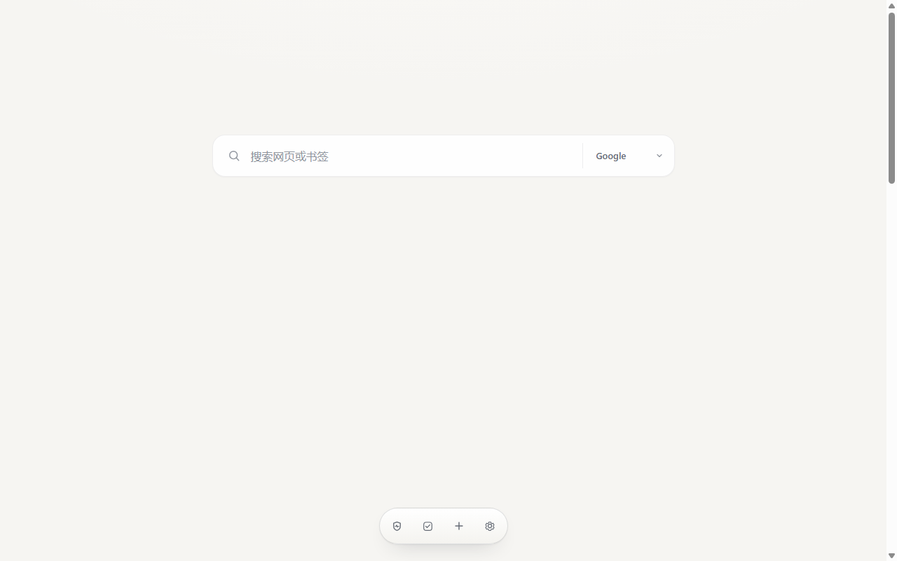
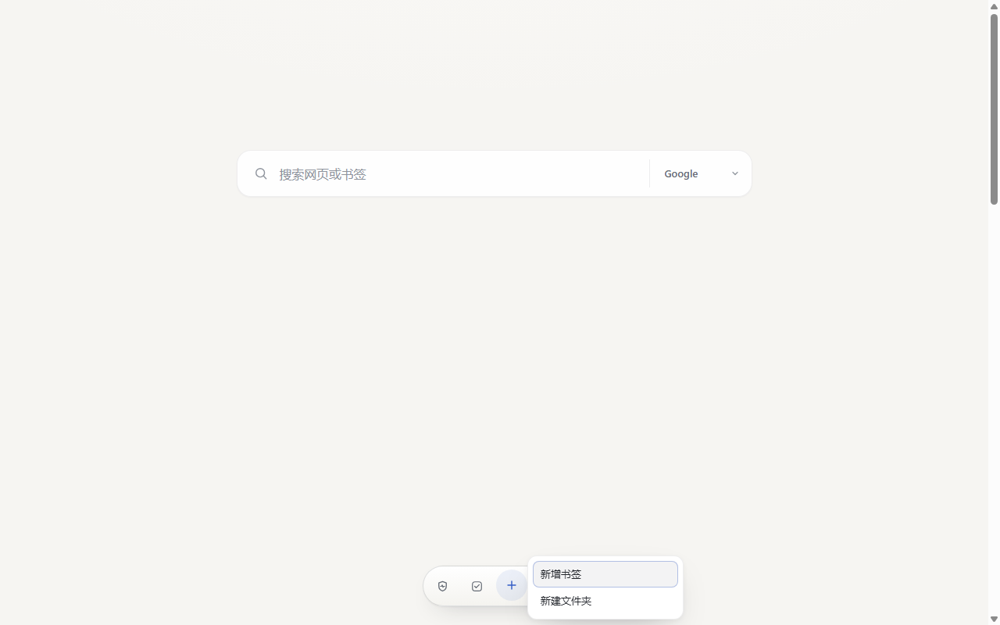

# Bookmark Home

[](https://github.com/Raycoi/bookmark-home/actions/workflows/ci.yml)
[](LICENSE)
[](https://developer.chrome.com/docs/extensions/develop/migrate)

把 Chrome 原生书签整理成一个干净、快速、可直接管理的新标签页。

Bookmark Home 直接使用 Chrome 书签，不建立第二套书签数据库。打开新标签页即可搜索、整理和检查书签；跨设备同步仍由 Chrome 自己负责。



## 功能

### 新标签页

- 直接展示 Chrome 书签栏、其他书签和嵌套文件夹。
- 常用网站以图标卡片展示，文件夹保持原有分类。
- 支持 Google、Bing、百度和 DuckDuckGo 搜索切换。
- 搜索框聚焦且未输入时显示最近打开的 6 条书签，可一键清空。
- 使用 Chrome 本地 `_favicon` 图标，不请求第三方 favicon 服务。
- 响应式布局，适配不同窗口宽度。
- 底部操作胶囊提供 4 个入口：网站健康、选择（多选）、添加、设置；鼠标移到页面
  底部中间时出现。
- 首次打开新标签页时有一次胶囊功能引导，完成后不再自动显示。

### 背景与语言

- 设置中可选择默认颜色、网络图片或本地图片作为背景，并调整透明度（0–70）。
- 网络图片由扩展页面直接请求你填写的图片地址，设置 `referrerpolicy="no-referrer"`。
- 本地图片在本地压缩到最长边不超过 1920×1080 的 WebP，再保存到本机，不上传。
- 语言支持“自动”“简体中文”“English”；自动模式按浏览器界面语言选择中/英。

### 书签管理

- 新增、编辑、删除书签。
- 新建、重命名、删除文件夹。
- 将书签或文件夹移动到其他位置。
- 拖拽调整顺序和移动位置。
- 右键菜单、更多菜单和快捷操作入口。
- 多选模式：逐项勾选、Shift 连续选择、全选，支持批量移动和批量删除。
- 删除后可在提示条中撤销；批量删除同样可以撤销。

| 书签管理 | 新增书签 |
|:---:|:---:|
|  |  |

### 网站健康检查

- 检查书签网址是否可以访问，结果显示在健康面板和状态筛选里。
- 状态包括：正常、已跳转、页面不存在、页面已移除、访问受限、服务器异常、无法确认，
  以及待检测、检测中、无法检测、内网地址和已忽略。
- 支持全部检测、异常网站筛选、单个重新检测和取消未执行的检测任务。
- 每一行都可以重新检测、编辑书签、在 Chrome 书签管理器中定位、忽略该网址或删除
  书签；已忽略的网址可以恢复检测。
- 动态并发：全局最多 6 个请求、同域最多 2 个，完成一个任务就更新一条结果。
- 新建书签、书签 URL 修改和完成书签导入后会自动入队；每分钟 tick 执行队列，每
  6 小时维护到期复检。
- 使用 HEAD，服务器不支持时回退到有限 GET；超时、网络错误和 5xx 至多重试一次。
- 对体积较小（Content-Length 不超过 64 KB）的 HTML 页面会额外读取最多 64 KB，
  用于识别软 404 和登录页；不会下载完整页面。
- 跳过内网和本机地址，避免把健康检查用于内网探测。
- **没有全局关闭开关**：检测会按上述触发方式运行，只能对单个 URL 选择忽略。


## 数据与隐私

- **唯一数据源**：Chrome 原生书签。扩展不建立独立书签数据库，也不保存完整书签树
  副本。
- **不上传书签**：没有开发者后端、第三方健康检查 API 或独立云同步。
- **跨设备同步**：由 Chrome 自身的账号同步负责，不由本扩展实现。
- **搜索偏好**：只把搜索引擎 ID（`bookmarkHome.searchEngineId`）保存到
  `chrome.storage.sync`。
- **本地设置**：`chrome.storage.local` 保存背景（`bookmarkHome.appearance`）、
  语言（`bookmarkHome.language`）、胶囊引导状态
  （`bookmarkHome.capsuleIntroCompleted`）和最多 6 条最近书签
  （`bookmarkHome.recentBookmarks`，含 id、标题、URL、文件夹路径和打开时间）。
- **健康检查记录**：只保存在本机 `chrome.storage.local`
  （`bookmarkHome.health.state`），清除扩展数据后需要重新检测。
- **不使用统计**：没有遥测、广告、崩溃上报或用户行为分析。

### 为什么需要访问所有网站的权限？

网站健康检查需要向书签中的 HTTP/HTTPS 地址发起请求，以获取 HTTP 状态和跳转结果，
因此使用了 `host_permissions: <all_urls>`。网络背景图由扩展页面直接请求用户填写
的图片地址。

扩展不会：

- 注入网页脚本；
- 读取用户当前打开网页的正文或 DOM；
- 读取 Cookie、浏览历史或登录状态；
- 在健康检查请求中携带登录 Cookie。

健康检查只会在体积和类型限制内读取目标页面的标题/一级标题文本，用于判断软 404
和登录页，不保存正文。

完整说明见 [隐私政策](PRIVACY.md)。

## 安装

正式安装方式是 **GitHub Release**，也可以从源码构建后加载解压目录。

1. 打开 [GitHub Releases](https://github.com/Raycoi/bookmark-home/releases)。
2. 下载最新版本的 `bookmark-home-<版本>-chrome.zip` 并解压。
3. 打开 `chrome://extensions`。
4. 开启右上角“开发者模式”。
5. 点击“加载已解压的扩展程序”，选择解压后的目录。
6. 打开新标签页。

Chrome 不能直接加载 ZIP，必须选择解压后的目录。

开发者从源码构建的步骤见下一节。ZIP 产物位于
`.output/bookmark-home-<版本>-chrome.zip`。

## 开发与构建

环境要求：

- Node.js >= 22
- pnpm 10

```bash
corepack enable
pnpm install --frozen-lockfile

pnpm dev            # 开发模式
pnpm check          # lint + typecheck + 单元测试 + build + zip + 产物校验
pnpm build          # 生产构建
pnpm zip            # 打包 Chrome ZIP
pnpm verify:extension
```

真实 Chrome 测试脚本位于 `scripts/browser/`，需要本地 Chrome、独立用户目录和测试 HTTP 服务。

## 技术栈

- [WXT](https://wxt.dev/) 构建 Chrome Manifest V3 扩展。
- [Vue 3](https://vuejs.org/) + TypeScript 实现新标签页。
- [Vitest](https://vitest.dev/) 运行单元测试。
- 后台使用 MV3 Service Worker、`chrome.bookmarks`、`chrome.storage` 和 `chrome.alarms`。

## 已知限制

- 仅支持 Chrome，不提供 Firefox、Edge 或 Safari 版本。
- 主页主要展示书签栏和其他书签；移动设备/额外区域书签不在主页展示。
- 删除后的撤销只在提示条显示期间有效，超时后不再保留快照。
- 触屏设备不能使用 HTML5 拖拽，但仍可通过菜单和批量移动操作书签。
- 健康检查没有全局开关，只能逐 URL 忽略。
- 健康检查无法识别依赖 JavaScript 渲染后才出现的内容；软 404 和登录页判断基于
  页面标题/一级标题和表单特征，可能误判或漏判。
- 最近书签只记录从新标签页打开的书签，最多 6 条，不同步。
- 语言的部分动态状态文案仍在迁移中，中英文内容可能不完全一致。
- 健康检查缓存保存在本机，清除扩展数据后需要重新检测。

## License

本项目使用 [MIT License](LICENSE)。
